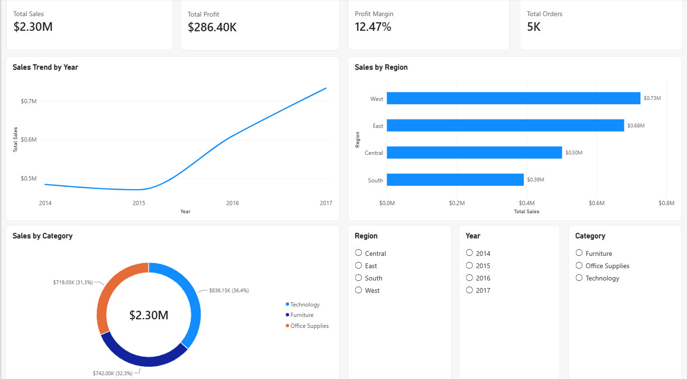

# Retail Sales Performance Dashboard

## 📌 Project Overview
This project is an end-to-end Power BI report analyzing 4 years of retail sales data (2014–2017) for a fictional Superstore. The goal was to uncover revenue trends, identify loss-making product segments, and provide actionable business recommendations to improve profitability.

## 📊 Dashboard Pages

### 1. Executive Summary
*   **KPIs:** Total Sales ($2.30M), Total Profit ($286.40K), Profit Margin (12.47%), Total Orders (5K).
*   **Visuals:** Line chart showing a 51% YoY sales growth, Regional performance (West leads at 32%), and Category breakdown.
*   **Interactivity:** Slicers for Region, Year, and Category.

### 2. Product Deep Dive
*   **Matrix:** Profitability breakdown by Category and Sub-Category using conditional formatting (red/green).
*   **Top N Analysis:** Dynamic filter showing the Top 10 products by revenue.
*   **Key Insight:** Identified that while overall profit is healthy, the **Tables (-$17.7K)** and **Bookcases (-$3.5K)** sub-categories are operating at a loss due to excessive discounting.

## 🛠️ Technical Skills Demonstrated
*   **Data Transformation:** Cleaned and shaped raw CSV data using Power Query (handling date locales, removing duplicates, splitting tables).
*   **Data Modeling:** Built a robust **Star Schema** consisting of 1 Fact table (`FactSales`) and 4 Dimension tables (`DimDate`, `DimProduct`, `DimCustomer`, `DimRegion`).
*   **DAX:** Created explicit measures (`Total Sales`, `Total Profit`, `Profit Margin`, `Total Orders`) and a dynamic Date Table using `CALENDAR()` and `FORMAT()`.
*   **UI/UX Design:** Implemented conditional formatting, custom tooltips, and a clean, grid-aligned layout for self-service BI.

## 📸 Screenshots

## 📂 Repository Contents
*   `Superstore_PL300_Portfolio.pbix` - The complete Power BI file.
*   `Sample - Superstore.csv` - The raw dataset used for the project.
*   `README.md` - Project documentation.
